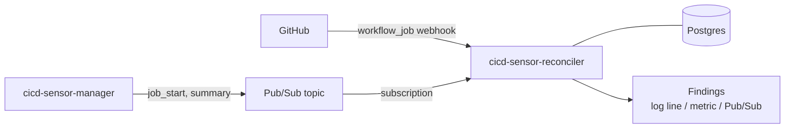

# Missing telemetry

A job with no sensor logs looks the same as a clean job.
`cicd-sensor-reconciler` closes that gap: it compares GitHub's own job list with the `job_start` and `summary` logs and reports completed jobs whose telemetry is missing.

It is an optional, separate service.
It runs downstream of the manager's Pub/Sub sink, and removing it does not affect log collection.



## Verdicts

Each completed job gets one verdict after a grace period (default 5 minutes after GitHub's `completed_at`).

| Verdict | Meaning | Finding |
| --- | --- | --- |
| `ok` | A `summary` log arrived. | no |
| `no_summary` | A `job_start` log arrived and no `summary`. The sensor started and did not finalize. | yes |
| `no_start` | No log arrived. The sensor never ran, or none of its logs were delivered. | yes |
| `not_expected` | The job never reached a runner (skipped, or cancelled while queued), or the expectation config excludes it. | no |

A `summary` without a `job_start` is `ok`, so the reconciler also works when `job_start` is not routed.
In that setup a killed sensor shows as `no_start` instead of `no_summary`.

A verdict is final.
A log that arrives after it is stored and counted in `cicd_sensor_reconciler_late_records_total`; raise `grace_period` if that counter grows.

After a start, the reconciler waits one `grace_period` before it decides any job, so logs queued in the subscription while it was down can be read first.
If the subscription lags by more than `grace_period`, jobs are decided before their logs are read and reported as findings.
Alert on the subscription's oldest unacked message age, and treat a growing `late_records_total` as a sign of false findings.

## Requirements

- Jobs are started through the GitHub Action on github.com, with an action version that passes `job.check_run_id` to the Agent.
  That ID is the join key: it equals the job `id` in GitHub's API and is unique per job, including matrix legs.
- The manager routes `summary`, and preferably `job_start`, to a `google_pubsub` sink. Object-storage sinks are not supported.
- A Postgres database.
- A GitHub webhook (repository, organization, or GitHub App) that sends `workflow_job` events to `https://<reconciler>/webhook/github`, with content type `application/json` and a secret.

Jobs started only by a runner hook, and jobs on GitHub Enterprise Server, have no check run ID in their logs.
Their logs are counted in `cicd_sensor_reconciler_unjoinable_records_total` and dropped, and their jobs would show as `no_start`.
Exclude those repositories or runner labels in `expect`.
GitLab jobs are not reconciled.

## Configuration

Secrets come from the environment, everything else from a YAML file.

| Input | Source |
| --- | --- |
| Config file | `--config-file` or `CICD_SENSOR_RECONCILER_CONFIG_FILE` |
| Postgres connection string | `CICD_SENSOR_RECONCILER_POSTGRES_DSN` |
| GitHub webhook secret | `CICD_SENSOR_RECONCILER_GITHUB_WEBHOOK_SECRET` |

```yaml
bind:
  address: "0.0.0.0"
  port: 8080

pubsub:
  project_id: security-prod
  subscription: cicd-sensor-reconciler

findings:
  pubsub_topic: cicd-sensor-findings

grace_period: 5m
reconcile_interval: 30s
retention: 720h

expect:
  repositories:
    include: ["acme/*"]
    exclude: ["acme/sandbox-*"]
  exclude_runner_labels: [macos-latest, windows-latest]
```

| Setting | Description | Default |
| --- | --- | --- |
| `bind` | Listen address and port. | `0.0.0.0:8080` |
| `pubsub.project_id`, `pubsub.subscription` | Subscription on the topic that receives `job_start` and `summary`. Other log types on the same topic are ignored. | required |
| `findings.pubsub_topic` | Topic in `pubsub.project_id` that receives one JSON message per finding. | disabled |
| `grace_period` | How long after `completed_at` logs may still arrive. | `5m` |
| `reconcile_interval` | How often verdicts are decided. | `30s` |
| `retention` | How long a job row is kept after its last update. | `720h` |
| `expect.repositories.include` / `exclude` | Globs over `owner/repo` (`*` does not cross `/`). An empty `include` matches every repository. `exclude` wins. | all repositories |
| `expect.exclude_runner_labels` | A job requesting any of these labels is `not_expected`. Use it for runners that cannot run the sensor. | none |

Without `expect`, every job in every repository that sends webhooks must run the sensor, and the finding stream will be noisy.

The reconciler creates its single table at startup.
Several replicas can share one database.

## Endpoints

| Path | Purpose |
| --- | --- |
| `POST /webhook/github` | `workflow_job` events. The `X-Hub-Signature-256` signature is verified before the body is parsed; a missing or wrong signature gets `401`. Bodies over 1 MiB get `413`. |
| `GET /healthz` | `200` when Postgres is reachable. |
| `GET /metrics` | Prometheus text format. |

All three are served on the same port.
Expose only `/webhook/github` publicly, for example with path-based routing at the ingress, and keep `/healthz` and `/metrics` internal: neither is authenticated, and `/healthz` queries Postgres on every request.

## Findings

Each `no_start` and `no_summary` job produces:

- a `missing_telemetry` log line on stderr,
- an increment of `cicd_sensor_reconciler_findings_total{verdict="..."}`,
- when `findings.pubsub_topic` is set, one message with `log_type` `cicd_sensor.missing_telemetry`.

```json
{
  "timestamp": "2026-11-20T19:10:00Z",
  "log_type": "cicd_sensor.missing_telemetry",
  "service_name": "cicd-sensor-reconciler",
  "schema_version": "v1",
  "log_id": "6f1c2a0e-5b7d-5c3a-9e41-2d8f0b6a7c15",
  "verdict": "no_summary",
  "provider_host": "github.com",
  "repository": "acme/example",
  "github_check_run_id": 136504227514,
  "github_run_id": 44798508261,
  "github_run_attempt": 1,
  "job_name": "build",
  "workflow_name": "ci",
  "runner_name": "GitHub Actions 1001602054",
  "labels": ["ubuntu-latest"],
  "conclusion": "success",
  "job_link": "https://github.com/acme/example/actions/runs/44798508261/job/136504227514",
  "completed_at": "2026-11-20T19:03:20Z",
  "start_seen_at": "2026-11-20T19:03:15Z"
}
```

A finding is delivered at least once.
If publishing fails or the verdict cannot be stored, that job keeps no verdict and is retried on the next pass, so a consumer may see a finding twice.
`log_id` is derived from the job and the verdict and is the same on every retry; deduplicate on it.
The log line and the counter are at least once too, so a retried job can be logged and counted twice.

Other metrics:

| Metric | Meaning |
| --- | --- |
| `cicd_sensor_reconciler_unjoinable_records_total` | Logs without a check run ID. |
| `cicd_sensor_reconciler_late_records_total` | Logs that arrived after their job's verdict. |
| `cicd_sensor_reconciler_invalid_records_total` | Logs whose identity attributes are missing or malformed. |
| `cicd_sensor_reconciler_webhook_signature_failures_total` | Rejected webhook requests. |
| `cicd_sensor_reconciler_records_without_provider_job` | Jobs the sensor reported that GitHub never told the reconciler about, older than the grace period. A non-zero value suggests lost webhook deliveries. |
| `cicd_sensor_reconciler_reconcile_errors_total` | Failed reconcile passes. |

## False findings

- **Jobs that end before the sensor step.** A job counts as having run as soon as a runner picks it up. A job that is cancelled or fails before the Action step starts the Agent (a `concurrency` group with `cancel-in-progress`, a failed checkout, a setup failure) is reported as `no_start`. Filter on `conclusion`, or expect a steady rate of these in repositories that cancel superseded runs.
- **Logs the manager failed to publish.** The manager's Pub/Sub sink publishes asynchronously and only logs a `pubsub_publish_failed` warning when a publish fails. A lost `job_start` or `summary` becomes a `no_start` or `no_summary` finding with nothing linking the two. Alert on that manager log line.
- **Subscription lag longer than `grace_period`**, as described under [Verdicts](#verdicts).

## What this does not detect

- **A job that forges its own logs.** A process that takes over a job with `id-token: write` can stop the Agent, mint its own token, and send a `passed` Summary for that same job. The verdict is then `ok`. Detections streamed before the takeover are still delivered. The manager only guarantees that a job cannot send logs as a *different* run or job.
- **Agents that authenticate with a manager token.** A static token carries no job identity, so those logs can claim any job.
- **Lost webhooks.** GitHub does not retry failed deliveries on its own. A job the reconciler never heard about is never flagged. Redeliver failed deliveries from GitHub (possible for 3 days), and watch the hook's delivery log.
- **Cancelled jobs are ambiguous.** A job cancelled after it started often has a `job_start` and no `summary`, because the runner was torn down. It is reported as `no_summary` with `conclusion: cancelled`; filter on `conclusion` if that is too noisy.

Whoever can edit the `expect` config can hide jobs from the reconciler.
Keep it with the platform team, not in the repositories it covers.
